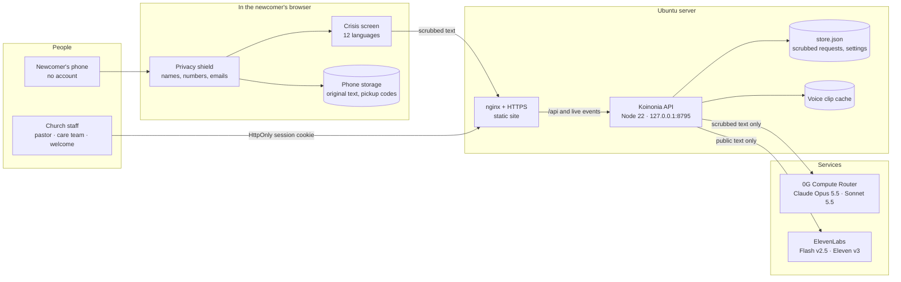
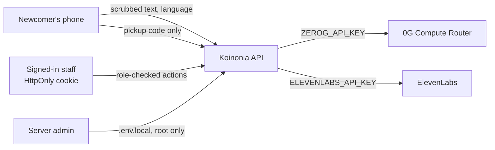
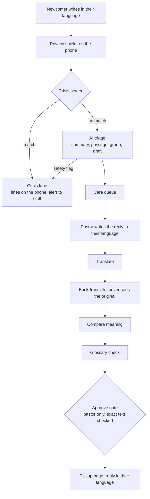
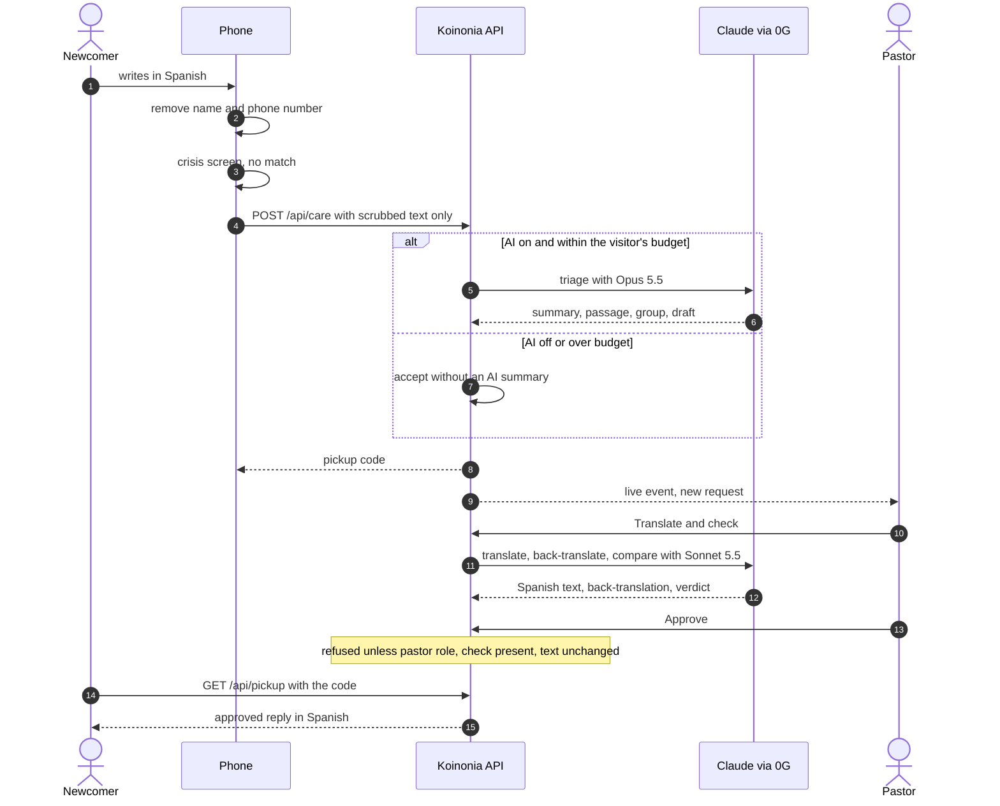
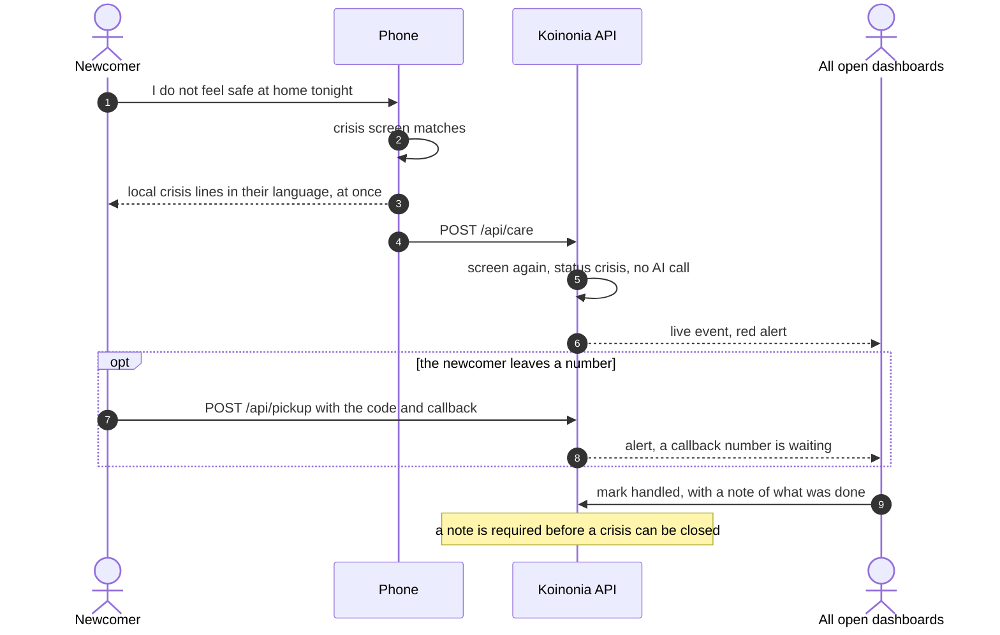
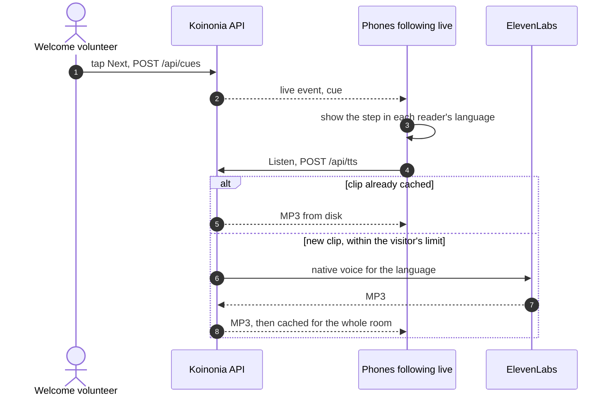
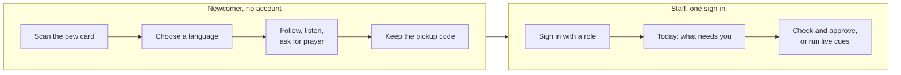

# Koinonia

**Every newcomer in the pew can be heard: they ask for prayer or help in their own language, and a pastor answers in theirs.**

Koinonia is a two-way pastoral care bridge for multilingual churches. A newcomer scans a card in the pew and writes in any of 12 languages; names, phone numbers, emails, student IDs and addresses are removed on their phone before anything is sent. The pastor reads an AI summary and writes the reply in their own language. Koinonia then translates the reply, translates it back with a separate AI call that never saw the original, and shows any change in meaning before the pastor can approve. Everything is measured against one rule: **nothing reaches a newcomer that a person has not read, checked and approved, and a cry for help is never answered by AI.**

- **Event:** AI for Church Hackathon 2026, Care & Community track.
- **Data:** sample data and fictional people; this is not an official parish tool.
- **App:** [koinonia.netlayerlabs.com](https://koinonia.netlayerlabs.com).
- **Demo video:** `<VIDEO_URL>`.
- **Code:** [github.com/NetLayerLabs/Koinonia](https://github.com/NetLayerLabs/Koinonia) (private, access on request).

**Judges, start here:**
1. Open [koinonia.netlayerlabs.com](https://koinonia.netlayerlabs.com) and choose **I'm visiting - open the pew page**. No account is needed.
2. In a second window, choose **Church staff sign in** and click **Fr. Andrea Ricci (Pastor)** to sign in with one click.
3. Write a prayer request on the pew page and watch it arrive in the Care Bridge.

The design system is in [DESIGN.md](DESIGN.md) and the deployment in [deploy/README.md](deploy/README.md).

---

## Six things to try

Newcomer pages need no account. Staff pages use one-click demo sign-in.

| Feature | What it is | Try it |
| --- | --- | --- |
| **The pew page** | What a newcomer sees after scanning the card. They pick one of 12 languages (English, Italian, Spanish, French, Portuguese, Polish, Ukrainian, Swahili, Vietnamese, Chinese, Korean, Arabic) and the whole interface switches; Arabic runs right to left throughout. It shows today's homily, the Bible passage (from stored text, never written by AI), a service guide and a 7-day reading habit. **Listen** reads the homily in a native ElevenLabs voice for that language. On a phone it behaves like a native app with a bottom tab bar. | `/#/pew?church=san-venanzio-unicam&lang=it`, then **Ascolta** |
| **Ask, privately** | The Prayer tab. As the newcomer types, `src/utils/privacyShield.ts` replaces details with tokens like `[PHONE_REDACTED_1]`, in the browser, before anything is sent. It catches self-introductions in seven languages and any letter case ("hola, me llamo Lucía"), phone numbers, emails, student IDs and street addresses. They get a private pickup code such as `9UR-SKP`. | Prayer tab on the pew page |
| **The Care Bridge** | The request arrives with details already removed, plus an AI summary, a suggested passage and group, and a draft reply. The pastor writes in English or Italian. **Translate and check** runs three steps: translation, an independent back-translation, and a comparison that highlights any phrase whose meaning changed. **Approve** stays locked until the check has run on the exact words being sent; a "major drift" verdict needs an explicit confirmation. *The AI drafts. A pastor decides.* | `/#/app/care` (signed in as Fr. Andrea) |
| **Read the reply** | The newcomer reads the approved reply with their code: the reply in their language, the attached passage and a group invitation. If the reply mentions their name, it is restored only on the phone that wrote the request (`src/lib/restore.ts`). Elsewhere the token is dropped. | `/#/pickup/<CODE>` |
| **The crisis lane** | Signs of self-harm, abuse or danger skip the queue and the AI. Two checks catch them: a keyword screen in 12 languages that runs in the browser and again on the server (`src/shared/crisis.ts`), and an AI safety flag on everything else. The phone shows local crisis lines in the newcomer's language at once (112 and 1522 in Italy; 911, 988 and the domestic violence hotline in the US). Every open dashboard raises a red alert, and staff must write what they did before closing it. *A crisis is never answered by AI.* | Prayer tab: "I don't feel safe at home tonight." |
| **The tradition glossary** | Catholics and Protestants use different words in the same language: 하느님 / 하나님, 天主 / 上帝, 미사 / 예배. A pastor approves the glossary once. Every translation is told to follow it and checked word by word, and the app's own interface follows it too: in Korean, the Catholic parish's Service tab reads 미사 and the Protestant church's reads 예배. | `/#/app/care`, then **Tradition glossary**, Korean, **Compare** |

### More to explore

| Feature | What it is | Where |
| --- | --- | --- |
| **Today** | The staff home: a greeting, a card for what needs you ("3 requests are waiting for a pastor"), urgent requests, and cards for the live service, this Sunday's notes, who is arriving and the Care Bridge. | `/#/app/today` |
| **Live service** | A volunteer taps **Next** and every phone with "Follow live" on moves to the same step, explained in its reader's language. It works over server-sent events, which keep a connection open so the server can push each step. | `/#/app/live` |
| **Language insights** | Each scan stores only a language and a time. Counts for the last 30 days are compared with the previous 30 and with the greeter rota, to suggest where a language group is arriving without a greeter who speaks it. | `/#/app/groups` |
| **Sunday notes** | Written once in English, then a three-item checklist a pastor must tick, then translated into the other 11 languages with the glossary and published to every pew page. | `/#/app/studio` |
| **Pew card** | A printable card with a real QR code for the pews. | `/#/app/qrkit` |
| **Roles** | **Pastor**: approves replies, the glossary and the Sunday notes. **Care team**: drafts and checks replies but cannot approve. **Welcome volunteer**: runs the live service and greeter planning, and cannot read care requests. The server enforces each role on every action (`src/shared/staff.ts`). | Sign-in page: Andrea, Grace, Minh |

**The shell.**
- **Landing page:** its hero is an animated rose window. The 12 petals are the 12 languages; red light travels in along the spokes (requests) and gold travels back out (replies).
- **Desktop staff app:** a full-height sidebar that folds into an icon rail (press `[`) and shows live waiting and urgent counts.
- **Phones:** a top bar, a bottom tab bar (Today, Care, Live, Pew, More) and a More screen.
- **Design:** the "missal" design system: two inks on paper, Alegreya type and custom icons, with no emoji (see [DESIGN.md](DESIGN.md)).
- **Sign-in:** only staff sign in; newcomers never need an account.

## Why the approval gate and on-phone privacy are essential

Without these, Koinonia would be a translation app that could hurt someone.

- **No check, no approval.** The approve route refuses unless a meaning check exists *and* the reply is word-for-word the text that was checked; a "major drift" verdict also needs `acknowledgedDrift` (`server/index.ts`, `/api/care/:id/approve`).
- **No pastor, no release.** `care:approve` belongs only to the pastor role (`src/shared/staff.ts`). Every staff route calls `requireStaff(permission)` on the server; hiding a button is never the only guard.
- **No personal details leave the phone.** The shield runs in the browser (`src/lib/submitCare.ts`). The server and the AI only receive the scrubbed text, and the original wording stays in the phone's local storage (`src/lib/local.ts`).
- **No AI on a crisis.** `createCare` runs the deterministic screen first; a match returns before any AI call. If the AI's safety flag fires later, the request is moved to the crisis lane without a draft.
- **No generic vocabulary.** The glossary goes into every translation prompt, and the output is checked with `checkGlossary` (`src/shared/glossary.ts`); the interface strings are passed through the same glossary (`src/lib/i18n/index.ts`).

## Architecture

Koinonia has five layers:
- **The browser:** a React single-page app, which runs the privacy shield and the crisis screen before anything is sent.
- **The API:** one Node process with plain `node:http` routes and live events.
- **The AI:** Claude, through the 0G Compute Router.
- **The voices:** ElevenLabs.
- **Storage:** a small JSON file and a voice-clip cache on the server.

In production it all runs on one Ubuntu server behind nginx.

### System overview



**One process, no database.** `server/index.ts` serves every route.
- **What it stores:** scrubbed requests, pickup codes, glossaries, live cues, published notes and staff sessions, all in `server/data/store.json` (`server/store.ts`). Sessions are stored as hashes, never raw tokens.
- **Voice clips:** cached as MP3 files in `server/data/tts/`.
- **nginx:** serves the built site from `dist/` and passes `/api` to the API with buffering off, so live events stream.

**Two Claude models.** Both come through the 0G Compute Router's Anthropic-compatible endpoint, using the official SDK (`server/ai.ts`):
- **Claude Opus 5.5** (`ZEROG_MODEL`) reads each request: the summary, the draft and the safety flag.
- **Claude Sonnet 5.5** (`ZEROG_FAST_MODEL`) does the translation work: translate, back-translate, compare, the Sunday notes and the interface strings.

On 0G, answers come back as a single tool call and are validated against a Zod schema. With an Anthropic key instead, the same functions use native structured outputs.

### Who holds which key



| Key or secret | Lives in | Can | Can never |
| --- | --- | --- | --- |
| `ZEROG_API_KEY` | Server `.env.local` (mode 600) | Call Claude through the 0G Compute Router for summaries, drafts and translations | Reach the browser; see raw personal details (only scrubbed text is sent) |
| `ELEVENLABS_API_KEY` | Server `.env.local` | Turn public text (homily, passage, service steps) into speech | Receive prayer requests or replies |
| `STAFF_PASSCODE` | Server `.env.local` | Sign staff in with a username | Be read by any page or API |
| Staff session | HttpOnly, Secure, SameSite=Strict cookie; only its SHA-256 hash is stored | Perform the actions the signed-in role allows | Be read by page scripts; approve a reply without the pastor role |
| Pickup code | The newcomer's phone | Read that one request's status and approved reply | List or read anyone else's requests |
| Original wording | The newcomer's phone only (local storage) | Restore their own name in the reply on that phone | Leave the phone |

### The care pipeline



The crisis check comes first and runs twice: once on the phone, so the crisis lines appear at once, and once on the server, which is the one that counts. Approval is a gate, not a button: the server checks the role, that a check exists, that the text is unchanged, and that any major drift was acknowledged.

### A prayer request, end to end



The visitor's AI budget never turns a request away: past the limit, the request still reaches the pastor, without the AI summary (`server/limits.ts`).

### The crisis lane



### Live service and read-aloud



One generation serves the whole room, so a full church listening to the same homily costs one clip.

### Getting started



**A real run, 21 November 2026 (UTC), against the live server:**
- **A Spanish request:** triaged by Opus 5.5 in 6 to 9 seconds. The meaning check (three Sonnet 5.5 calls) took 13 seconds; on Opus alone it had taken 79.
- **Approval and pickup:** after approval, the pickup page returned the reply in Spanish.
- **Crisis:** "I don't feel safe at home tonight" went straight to the crisis lane.
- **Sunday notes:** published into all 12 languages in 17 seconds, with no glossary problems.
- **Voices:** an ElevenLabs clip came back, and a repeat request was served from the cache in 3 milliseconds.
- **Reset:** `/api/reset` was refused with 403 on the public demo.

## Safety and security model

- **What the AI can do:** summarise, suggest a passage and a group by id, draft, translate, back-translate, compare meaning and translate the Sunday notes.
- **What the AI can never do:**
  - see names, numbers or addresses;
  - write or translate Bible text, since passages are shown from stored text by id;
  - answer a crisis;
  - send anything without a pastor's approval;
  - put a redaction token in a reply. The prompt forbids it, and on another device any leftover token is dropped.
- **Server-enforced roles:**
  - every staff route checks the signed-in role (`requireStaff` in `server/index.ts`);
  - the care team's Approve button is locked in the UI *and* refused by the server;
  - welcome volunteers get 403 on the care queue.
- **Sign-in:**
  - sessions last 12 hours;
  - after 8 wrong passwords, sign-in is locked for 15 minutes, counted per address as seen by the proxy, which cannot be spoofed with a forwarded header;
  - unknown usernames and wrong passwords get the same message (`server/auth.ts`).
- **Public demo safeguards** (`PUBLIC_DEMO=true`, `server/limits.ts`):
  - per visitor: 6 prayer requests with an AI summary per 10 minutes, 30 AI checks or comparisons per 10 minutes, 3 publishes per hour, and 20 new voice clips per 10 minutes;
  - crisis requests never count, and no request is ever turned away;
  - manual reset is refused, and the data resets to clean samples nightly at 08:00 UTC;
  - the status endpoint hides the server's internal addresses.
- **Input limits:** request bodies are capped at 1 MB, text fields are length-capped, and read-aloud text is capped at 4,000 characters.
- **Tests:** there is no automated test suite yet. `npm run typecheck` passes and `npm run build` succeeds (21 November 2026, 13:02 UTC). The flows above were run end to end against the live server the same day.

## What's real and what's sample

| Real | Sample or simulated |
| --- | --- |
| Claude triage, drafts, translation, back-translation and the meaning check, live through 0G Compute | The two churches: a Catholic university parish in Camerino and a Protestant church in Austin. Both are sample profiles, inspired by real places but not official tools |
| The privacy shield and the crisis screen, in the browser and on the server | Every person in the data (clergy, staff, volunteers) is fictional |
| Pickup codes, the approval gate, roles and sessions, live events | The Bible passages are demo text; a church would connect its licensed translation |
| ElevenLabs native voices for all 12 languages | The language-insights history is generated sample data and labelled as such in the app; real scans are added on top |
| Publishing Sunday notes into 12 languages with the glossary | The greeter rota, volunteer gaps and the newsletter impact story are sample text; no invitations are sent |
| The interface in 12 languages | The interface translations were made once by Claude and say so in the app; they have not yet been checked by native speakers |

## Tech stack

**Front end:**
- React 19.3, Vite 6.4, Tailwind CSS 4.3, TypeScript 5.7;
- lucide-react for plain controls, plus a custom icon set;
- qrcode 1.5 for the pew card.

**Server:**
- Node 22.18 or later, which runs the TypeScript directly with no build step, with `node:http` and server-sent events;
- `@anthropic-ai/sdk` 1.10 and Zod 4.6.

**AI and voices:**
- Claude Opus 5.5 and Claude Sonnet 5.5 through the 0G Compute Router (or the Anthropic API directly);
- ElevenLabs Flash v2.5 and Eleven v3.

**Typefaces:** Alegreya, Alegreya Sans, IBM Plex Mono and Noto Naskh Arabic.

**Hosting:** Ubuntu 24.04, nginx with Let's Encrypt, and systemd.

## Run it locally

**Prerequisites:** Node 22.18 or later (developed on Node 26) and npm. Live AI and native voices need keys; without them, everything still runs in clearly labelled sample mode.

| Variable | What it does | If unset |
| --- | --- | --- |
| `ZEROG_API_KEY` | Live AI through the 0G Compute Router (preferred) | Falls back to `ANTHROPIC_API_KEY`, else sample mode |
| `ZEROG_MODEL` | Model for reading requests | `claude-opus-5.5` |
| `ZEROG_FAST_MODEL` | Model for translation and the meaning check | Same as `ZEROG_MODEL` |
| `ZEROG_BASE_URL` | Router address | `https://router-api.0g.ai` |
| `ANTHROPIC_API_KEY` | Live AI through the Anthropic API directly | Sample mode if no 0G key either |
| `STAFF_PASSCODE` | Password for staff usernames | Username and password sign-in is off |
| `DEMO_LOGIN` | One-click demo accounts on the sign-in page | Off (`false`) |
| `PUBLIC_DEMO` | Visitor AI budgets, no manual reset, nightly reset | Off |
| `RESET_HOUR_UTC` | Hour of the nightly reset | `8` |
| `ELEVENLABS_API_KEY` | Native read-aloud voices | Phone's own voice |
| `ELEVENLABS_ENV_FILE` | Path to another `.env` file holding the ElevenLabs key | Not used |
| `KOINONIA_API_PORT` | API port | `8787` |

Put them in `.env.local` (git-ignored); `.env.example` lists them all.

```bash
npm install
cp .env.example .env.local   # then fill in what you have
npm run dev                  # website http://localhost:5180 + API 127.0.0.1:8787
npm run typecheck            # app and server
npm run build                # production build into dist/
```

To regenerate the interface translations after changing `src/lib/i18n/en.ts`, run this (it translates only missing keys):

```bash
node --env-file-if-exists=.env.local server/scripts/translate-ui.ts
```

> **Status, 21 November 2026, 13:02 UTC:** `npm run typecheck` completes with no errors; `npm run build` reports `✓ 2235 modules transformed` and `✓ built in 1.02s`. There is no automated test suite yet.

## Deploying

The full guide is in [deploy/README.md](deploy/README.md).

1. **Server:** any Ubuntu machine with Node 22.18 or later, nginx and certbot. Koinonia uses its own folder (`/opt/koinonia`), its own port (8795, localhost only) and its own nginx site, so it can share a server with other apps.
2. **DNS:** an A record for the subdomain pointing at the server (here `koinonia.netlayerlabs.com`).
3. **Code:** run `deploy/deploy.sh root@SERVER`. It copies the code (never `.env` files or saved data), runs `npm ci` and `npm run build` on the server, and restarts the service.
4. **Settings:** `/opt/koinonia/.env.local`, mode 600, with the keys, `PUBLIC_DEMO=true`, `DEMO_LOGIN=true`, `ZEROG_FAST_MODEL=claude-sonnet-5.5` and `KOINONIA_API_PORT=8795`.
5. **Service:** `deploy/koinonia.service` installed under systemd, which restarts it on failure and at boot. Logs: `journalctl -u koinonia -f`.
6. **Site and HTTPS:** `deploy/nginx-koinonia.conf`. Test with `nginx -t` before reloading, then run `certbot --nginx -d <your subdomain>`.
7. **Scheduling:** no external scheduler is needed. The nightly reset runs inside the API process when `PUBLIC_DEMO=true`.
8. **First live run:** 21 November 2026, at [koinonia.netlayerlabs.com](https://koinonia.netlayerlabs.com). The results are in "A real run" above.

## Repository map

```text
index.html                 page shell, typefaces, favicons
public/
  brand/                   Koinonia logo: full and window mark, ink and light versions
  shots/                   real screenshots of the app used on the landing page
server/
  index.ts                 the API: care queue, approval gate, crisis lane, pickup, glossary,
                           live events, Sunday notes, read-aloud, sign-in
  ai.ts                    Claude calls (triage, translate, back-translate, compare, notes, UI strings)
  auth.ts                  staff sessions, passcode, lockout
  limits.ts                public-demo budgets and the nightly reset
  tts.ts                   ElevenLabs voices and the clip cache
  store.ts                 JSON store (scrubbed data only)
  sample.ts                labelled sample output when AI is off
  scripts/translate-ui.ts  one-time interface translation
src/
  App.tsx                  routes, staff gate, sidebar and phone tab bar
  shared/                  code used by browser and server: crisis screen, glossary,
                           languages, roster, staff roles, API types
  utils/privacyShield.ts   removes personal details on the phone
  lib/                     API client, live events, read-aloud, on-device restore,
                           local storage, router; i18n/ holds the 12 interface languages
  components/              Landing, LivePewCompanion (pew page), PickupPage, CrisisPanel,
                           CareBridge, GlossaryPanel, TodayPage, LiveServiceConsole,
                           LanguageInsights, CommunityAndVolunteerHub,
                           MinistryBridgeAndImpactStudio (Sunday notes), StaffLogin,
                           StaffSidebar, MorePage, PrintablePewQRAndRubricView
  components/brand/        logo, custom icons, language tiles, flags, rose window,
                           iPhone frame, scroll reveal
  data/koinoniaData.ts     the two sample church profiles (fictional people)
  index.css                the "missal" design system
deploy/                    nginx site, systemd unit, deploy script, guide
DESIGN.md                  design system rules
SUBMISSION_GUIDE.md        hackathon description, video script, checklist
```

## Content policy

- **Inspired by, not representing:** the Basilica di San Venanzio and the University of Camerino are real places that inspired the project. The parish profile is sample data, not an official parish tool, and every person in it is fictional.
- **Scripture:** the Bible passages are demo text. The app never asks the AI to write or translate Scripture; a church would connect its licensed translation.
- **Languages are not countries:** flags appear only next to a language's name, never in place of it. The language tiles use each language's own script.
- **Labelled:** machine-made interface translations, generated sample history and sample impact text are all labelled in the app.

## Pre-existing work and credits

- **Starting point:** an earlier Koinonia prototype by the same author (a front-end mock-up with sample church data). During the hackathon it was rebuilt into a working app: the server, AI, privacy shield, crisis lane, roles, voices, localisation, design system, phone app and deployment.
- **Libraries and services:**
  - React, Vite, Tailwind CSS, TypeScript, lucide-react, qrcode and Zod (MIT or ISC licences);
  - the Anthropic TypeScript SDK;
  - typefaces from Google Fonts (SIL Open Font License);
  - ElevenLabs voices from its voice library, used under the account's plan;
  - Claude, served through the 0G Compute Network.
- **Design references, not code:** the HSL (Helsinki transport) app for the phone tab-bar pattern; Fluenci and Brokro for the collapsible sidebar.
- **Built with:** Claude Code.

## License

No open-source licence yet. © 2026 Netlayer Labs, all rights reserved.

---

Koinonia supports pastoral care; it does not replace it. It is not a crisis service: in an emergency, call your local emergency number.
